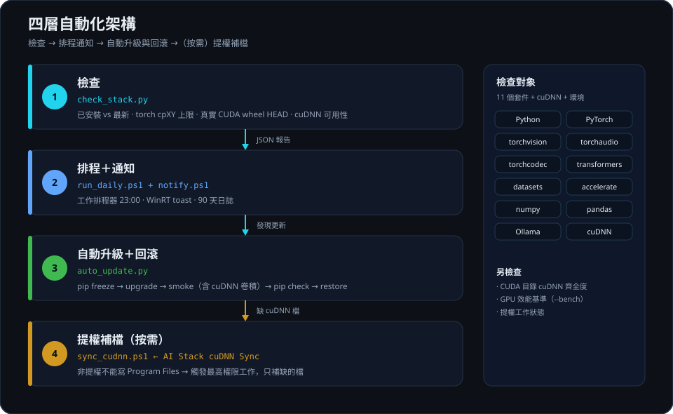
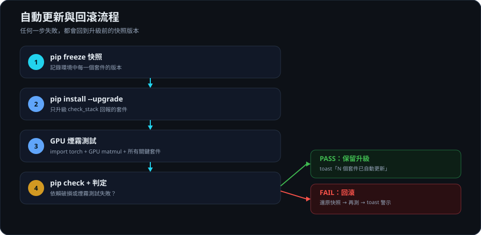

# ai-stack-update-check

[](https://github.com/kalpakjian/ai-stack-update-check/actions/workflows/ci.yml)
[](https://github.com/kalpakjian/ai-stack-update-check/releases)
[](LICENSE)
[](https://www.python.org/)
[]()

Check, notify, and **safely auto-update** a local AI stack on Windows:
Python, PyTorch (CUDA wheels), **cuDNN readiness**, torchvision, torchaudio,
torchcodec, transformers, datasets, accelerate, numpy, pandas, and Ollama.

The core rule: **a newer Python is not always a safe Python.** PyTorch ships
wheels only up to a specific `cpXY` tag, so this tool derives compatibility from
real wheel filenames instead of trusting version numbers.

## Why this exists

On 2026-10-21 the machine had Python **3.15.0** available, but torch 2.14.1
shipped wheels only up to **cp314**. Upgrading Python would have broken
`import torch`. At the same time, the PyTorch index listed `cu129` and `cu134`
directories that contained **no Windows wheels at all** — so "newest CUDA index"
was not the same as "newest usable CUDA build".

This tool answers three questions in one pass:

| Question | How it is answered |
|---|---|
| Is there a newer version? | PyPI JSON + endoflife.date |
| Can I actually install it? | Real `HEAD` request for the platform wheel |
| Is it safe to upgrade Python? | Max `cpXY` tag across torch's wheels |

## Features

- **One-shot report** — current vs latest for the whole stack, with a clear status.
- **Wheel-aware** — checks actual `win_amd64` wheels on the PyTorch CUDA index.
- **cuDNN aware** — by default it scans `torch\lib\cudnn*.dll` (no torch import);
  with `--runtime` it verifies `torch.backends.cudnn.is_available()` /
  `version()`, reports the cudnn DLL torch actually loaded, and runs a real
  cuDNN convolution. cuDNN ships inside the torch wheel, so it is never
  suggested as a pip upgrade.
- **cuDNN copy check** — compares `CUDNN\v*` against `CUDA\v*` so a forgotten
  `include` (or a forgotten CUDA-version folder in the installer path) shows up
  as a warning instead of a silent gap.
- **Self-healing cuDNN copies** — one elevated scheduled task (registered once)
  lets the non-elevated daily job repair the CUDA toolkit layout on demand
  (`--fix-cudnn`), because `Program Files` needs administrator rights.
- **GPU benchmark** — `bench_gpu.py` measures cuBLAS matmul (TF32 on/off, fp16,
  bf16), cuDNN convolutions (fp32/TF32/fp16, `channels_last`), the
  `cudnn.benchmark` autotune, flash attention, and two cached HF baselines.
  `check_stack.py --bench` folds it into the report; `auto_update.py --bench`
  compares before/after an upgrade.
- **Python guard** — reports "newer exists (torch max 3.14)" instead of telling you
  to break your GPU environment.
- **JSON output** — `--json` / `--json-out` for scripts and CI.
- **Daily schedule** — Task Scheduler wrapper with rotated logs (90 days).
- **Desktop toast** — WinRT notification, no third-party module required.
- **Auto-update with rollback** — snapshot, upgrade, GPU smoke test, `pip check`,
  and automatic restore on failure.

## How it works



`check_stack.py` produces a JSON report with the current/latest versions, the
torch Python ceiling, and the cuDNN status. The scheduled wrapper
(`run_daily.ps1`) decides whether to notify and, with `-AutoUpdate`, calls
`auto_update.py` to snapshot, upgrade, run a GPU + cuDNN smoke test, and roll
back on failure.


## Requirements

- Windows 10/11
- Python 3.10+ (tested on 3.14.8)
- No third-party Python packages — the checker uses only the standard library
- Optional: NVIDIA GPU for `--runtime` and the full smoke test
- Optional: Ollama running on `http://localhost:11434`

## Quick start

```powershell
git clone https://github.com/kalpakjian/ai-stack-update-check.git
cd ai-stack-update-check

python scripts\check_stack.py
python scripts\check_stack.py --json
python scripts\check_stack.py --runtime
python scripts\check_stack.py --no-network
```

### Auto-update (opt-in)

```powershell
# Preview what would be installed
powershell -File scripts\run_daily.ps1 -AutoUpdate -DryRun

# Check + upgrade + smoke test + rollback on failure
powershell -File scripts\run_daily.ps1 -AutoUpdate

# Test the toast without waiting for an update
powershell -File scripts\run_daily.ps1 -ForceNotify

# Check + upgrade + smoke test + rollback, with a before/after GPU benchmark
powershell -File scripts\run_daily.ps1 -AutoUpdate -Bench
```

### Options

| Flag | Meaning |
|---|---|
| `--json` | Print the full report as JSON |
| `--json-out PATH` | Also write the JSON report to a file |
| `--runtime` | Import torch and verify CUDA **and cuDNN** availability (slower) |
| `--bench` | Also run the GPU benchmark (`scripts/bench_gpu.py`) |
| `--bench-quick` | With `--bench`: fast subset (no HF baselines) |
| `--fix-cudnn` | If cuDNN files are missing from the CUDA toolkit, trigger the elevated `AI Stack cuDNN Sync` task and re-scan |
| `--no-network` | Skip online checks; only list installed versions |

Exit codes: `0` = no actionable updates (a Python upgrade blocked by torch still
counts as 0), `1` = at least one package can be updated, `2` = bad arguments.

## Sample output

```
======================================================================================
AI Stack Update Check   2026-10-21T10:33:43+08:00
Interpreter: C:\Python314\python.exe
======================================================================================
Component     Installed           Latest            Status
--------------------------------------------------------------------------------------
Python        3.14.8              3.15.0            newer exists (torch max 3.14)
torch         2.14.1+cu132        2.14.1            up to date
torchvision   0.29.1+cu132        0.29.1            up to date
torchaudio    2.11.0              2.11.0            up to date
torchcodec    0.17.0              0.17.0            up to date
transformers  5.20.2              5.20.2            up to date
datasets      5.1.0               5.1.0             up to date
accelerate    1.15.0              1.15.0            up to date
numpy         2.5.4               2.5.4             up to date
pandas        3.0.6               3.0.6             up to date
cuDNN         9.24.0              -                 ok
Ollama        0.40.6              0.40.6            up to date
--------------------------------------------------------------------------------------
GPU: NVIDIA GeForce RTX 4090 | driver 617.42 | CUDA 13.4
Runtime: 2.14.1+cu132 | CUDA available: True | NVIDIA GeForce RTX 4090 | cuDNN 9.24.0 (cudnn64_9.dll)
Ollama models: 21

Warnings:
  ! cuDNN v9.22 -> CUDA v13.2: 8 file(s) missing (bin 10/10, include 0/8, lib 29/29) - the cuDNN
    files are not fully copied into the CUDA toolkit: include\cudnn.h, include\cudnn_ops.h, ...

Notes:
  - Python 3.15.0 is out, but the newest torch wheel only supports up to 3.14 (cp314);
    upgrading now would break PyTorch.
  - CUDA build: cu132 (newest available for Windows: cu132)
  - cuDNN 9.24.0 available (ships inside the torch wheel; loaded from ...\torch\lib\cudnn64_9.dll).
  - cuDNN v9.26 -> CUDA v13.4: bin 10/10, include 9/9, lib 29/29 (complete).

Suggested commands:
  # Python 3.15.0: do not upgrade yet; wait for a torch cp315 wheel

Result: no safe Python upgrade yet (blocked by torch wheel support).
```

## Daily schedule (Windows Task Scheduler)

```powershell
$ps = "$env:SystemRoot\System32\WindowsPowerShell\v1.0\powershell.exe"
$script = "$PWD\scripts\run_daily.ps1"
$arg = '-NoProfile -NonInteractive -ExecutionPolicy Bypass -WindowStyle Hidden -File "' + $script + '" -AutoUpdate'
Register-ScheduledTask -TaskName 'AI Stack Update Check' `
  -Action (New-ScheduledTaskAction -Execute $ps -Argument $arg) `
  -Trigger (New-ScheduledTaskTrigger -Daily -At 23:00) `
  -Settings (New-ScheduledTaskSettingsSet -StartWhenAvailable) -Force
```

Artifacts (default log directory: `%USERPROFILE%\ai-stack-logs`):

| File | Contents |
|---|---|
| `stack-check-YYYY-MM-DD.log` | full run log |
| `stack-check-latest.log` | last 60 lines |
| `stack-check-status.txt` | `OK` / `AUTO_UPDATED: ...` / `ROLLED_BACK: ...` / `ROLLBACK_FAILED` / `CUDNN_PROBLEM: ...` |
| `stack-report.json` | checker report |
| `auto-update-summary.json` | before/after, changed, smoke, rollback |

The task runs only while the user is logged on. If the machine is off or asleep
at the scheduled time, `StartWhenAvailable` runs it on the next wake.

## Auto-update policy

| Category | Packages | Behavior |
|---|---|---|
| General | transformers, datasets, accelerate, numpy, pandas | auto-upgrade |
| Audio | torchaudio, torchcodec | auto-upgrade from PyPI |
| PyTorch | torch, torchvision | auto-upgrade **only** when a matching Windows wheel exists for the running Python; uses the newest usable CUDA index |
| Python | CPython | never automatic |
| Ollama | ollama | never automatic (service restart) |
| CUDA-only | same torch version, newer CUDA build | never automatic (often a ~2 GB download) |
| cuDNN | bundled with the torch wheel | never a separate upgrade — it only changes when the torch wheel changes |

## cuDNN (readiness, not updates)

cuDNN is NVIDIA's deep-learning acceleration library (convolutions, attention,
matmul). On Windows PyTorch does not install it as a separate pip package — it
**ships inside the torch wheel** (`torch\lib\cudnn*_9.dll`, ~540 MB here), which
is why this tool verifies it but never lists it as an update.

| Status | Meaning |
|---|---|
| `ok` | `torch.backends.cudnn.is_available()` is True and `version()` returns a number |
| `present (not verified)` | cuDNN libraries found next to torch, but this run had no `--runtime` |
| `not available` | torch is installed and CUDA works, but cuDNN is unusable → reinstall the matching torch wheel |
| `not found` | no cuDNN library found next to torch |
| `not installed` | torch is not installed in this interpreter |
| `check failed` | the `--runtime` probe could not import torch |

> **Gotcha — do not ask the DLL directly.** Loading `cudnn64_9.dll` yourself and
> calling `cudnnGetVersion()` can return the *wrong* version. Measured on this
> machine: a bare `ctypes.WinDLL` of torch's 9.24.0 copy pulled
> `cudnn_graph64_9.dll` from the CUDA 13.4 toolkit (9.26.0) and reported
> **9.26.0**, while torch itself reports **9.24.0** (both `torch.backends.cudnn
> .version()` and `cudnnGetVersion()` inside the torch process agree). torch
> preloads `torch\lib\*.dll` with `LoadLibraryExW(..., 0x1100)` so its own copy
> always wins. Trust `--runtime`, not an ad-hoc DLL load.

### Is cuDNN fully copied into the CUDA toolkit?

The cuDNN zip/installer only *unpacks* the files — `bin`, `include` and `lib\x64`
still have to be copied into `C:\Program Files\NVIDIA GPU Computing Toolkit\CUDA\vXX.X\`.
The checker compares `CUDNN\v*` against `CUDA\v*` by file name and size (no
hashing of the GB-sized static libs):

- complete → one `Notes` line: `cuDNN v9.26 -> CUDA v13.4: bin 10/10, include 9/9, lib 29/29 (complete).`
- missing → a `Warnings` line with `bin 10/10, include 0/8, ...`, the missing file
  names, and a ready-to-run `Copy-Item` command (needs an elevated shell).

`bin\` and `bin\x64\` both count as "copied" (both are on `PATH`). The installer
layout has an extra CUDA-version folder (`bin\13.2\x64`, `include\13.2`); omitting
it matches **zero** files and copies nothing — silently. That is how `include`
ends up missing most of the time.

### Automating the copy (one-time setup)

Copying into `C:\Program Files\...` needs administrator rights, and the daily task
runs unelevated. The fix is a dedicated **highest-privilege** scheduled task that
the unelevated job can start on demand (`schtasks /run` on your own task does not
raise a UAC prompt):

```powershell
# (1) once, as administrator (-LogDir should match your daily job's log directory)
powershell -NoProfile -ExecutionPolicy Bypass -File scripts\register_cudnn_sync_task.ps1 `
  -LogDir "C:\Users\princ\ml-demos\logs"

# (2) from then on, no elevation needed
python scripts\check_stack.py --fix-cudnn     # detect -> trigger the task -> wait -> re-scan
powershell -File scripts\run_daily.ps1        # auto-adds --fix-cudnn when the task exists

# (3) manual test / log / removal (default log dir: %USERPROFILE%\ai-stack-logs)
schtasks /run /tn "AI Stack cuDNN Sync"
Get-Content "C:\Users\princ\ml-demos\logs\cudnn-sync-YYYY-MM-DD.log"
powershell -File scripts\register_cudnn_sync_task.ps1 -Unregister
```

`scripts\sync_cudnn.ps1` (the task body) discovers every `CUDNN\v*` ↔ `CUDA\v*`
pair, copies only what is missing, is idempotent, supports `-WhatIf`, and exits
`0` (nothing to do) / `1` (copied) / `2` (error, e.g. not elevated).
`run_daily.ps1` enables the fix automatically when the task is registered
(`-FixCudnn` forces it, `-NoFixCudnn` disables it).

## How rollback works



1. `pip freeze` snapshot before touching anything.
2. Upgrade via `pip install --upgrade ...`.
3. Smoke test: import every key package, run a GPU matmul and a cuDNN
   convolution — it fails if CUDA is available but cuDNN is not.
4. `pip check` for broken requirements.
5. On any failure: reinstall only the packages that changed, pinned to the
   snapshot version (`--force-reinstall --no-deps`), using the **original CUDA
   index** for torch builds. Newly added packages are uninstalled.
6. Re-run the smoke test and compare `pip freeze` with the snapshot; any mismatch
   marks the rollback as failed.

Exit codes for `auto_update.py`: `0` success/no-op, `1` rolled back, `2` rollback failed.

With `--bench`, the GPU benchmark runs before the upgrade and again after a
successful one; `bench_before`, `bench_after` and `bench_delta` (per-metric
percent change, plus whether higher or lower is better) land in
`auto-update-summary.json`.

## GPU benchmark

`scripts/bench_gpu.py` measures the paths that matter for a local AI stack. Output
is English-only (Windows consoles mangle Chinese when redirected); `--json-out`
writes the same numbers as JSON.

| Block | What it measures |
|---|---|
| `[cuBLAS]` | matmul 4096³ — fp32 (TF32 off/on), fp16, bf16 → ms and TFLOPS |
| `[cuDNN]` | conv2d — ResNet stem (224) and mid (56) in fp32/TF32/fp16, contiguous vs `channels_last` |
| `[cuDNN] benchmark` | `torch.backends.cudnn.benchmark` on/off, including autotune time |
| `[attention]` | SDPA fp16 (flash attention) latency and TFLOPS |
| `[HF baselines]` | cached models, offline: DistilBERT SST-2 texts/s, ViT-base 224 ms/img |

Measured baseline (2026-10-22, RTX 4090 / torch 2.14.1+cu132 / cuDNN 9.24.0):

| Metric | Value | Note |
|---|---|---|
| matmul fp32 (TF32 off → on) | 59.8 → **82.5 TFLOPS** | TF32 +38% |
| matmul fp16 / bf16 | **185.4** / 159.5 TFLOPS | |
| conv mid 56 fp32 → fp16 → fp16+`channels_last` | 1.771 → 1.020 → **0.790 ms** | 2.24×; VRAM 656 → 107 MB |
| `cudnn.benchmark` on/off | 1.836 → 1.836 ms (1.00×) | no gain for a fixed shape; autotune costs 0.03 s |
| SDPA fp16 (flash) | 0.074 ms / 116.3 TFLOPS | |
| DistilBERT SST-2 (batch 64) | **3,130 texts/s** | blog baseline 3,243 texts/s (within 4%) |
| ViT-base 224 (batch 1 / 32) | 5.51 / 1.00 ms/img | blog baseline 5.7 ms/img |

```powershell
python scripts\bench_gpu.py                                   # full (~1 min)
python scripts\bench_gpu.py --skip-hf                         # micro only
python scripts\bench_gpu.py --only-hf --db-batch 64 --vit-batch 1
python scripts\bench_gpu.py --quick --json-out bench.json     # fast before/after runs
```

Three knobs it quantifies: `torch.backends.cuda.matmul.allow_tf32` (fp32 matmul
+38%), AMP + `channels_last` (conv up to 2.24×), and `cudnn.benchmark` (only worth
it when input shapes vary).

## Data sources

| Data | Source |
|---|---|
| Installed versions | `importlib.metadata` (no imports) |
| Latest Python / EOL | `https://endoflife.date/api/python.json` |
| Latest packages | `https://pypi.org/pypi/<pkg>/json` |
| Max Python for torch | `cp3XY` tags in torch wheel filenames |
| Newest usable CUDA | `https://download.pytorch.org/whl/` + real wheel `HEAD` |
| cuDNN files (default) | `torch\lib\cudnn*.dll` scan (Linux: `nvidia/cudnn/lib`) — no torch import |
| cuDNN availability / version (`--runtime`) | `torch.backends.cudnn.is_available()` / `version()` + `GetModuleHandleW` for the loaded path |
| cuDNN copied into CUDA | `CUDNN\v*` vs `CUDA\v*` file names + sizes (`bin`, `include`, `lib\x64`) |
| GPU benchmark | `scripts/bench_gpu.py` — CUDA events, cached HF models run offline |
| Ollama local / latest | `http://localhost:11434/api/version`, GitHub Releases |
| GPU / driver | `nvidia-smi` (`CUDA UMD Version` or `CUDA Version`) |

## Tested environment

| Component | Version |
|---|---|
| OS | Windows 11 Pro (26220) |
| Python | 3.14.8 |
| torch / torchvision | 2.14.1+cu132 / 0.29.1+cu132 |
| cuDNN | 9.24.0 (bundled in torch 2.14.1+cu132, `torch\lib\cudnn64_9.dll`) |
| torchaudio / torchcodec | 2.11.0 / 0.17.0 |
| transformers / datasets / accelerate | 5.20.2 / 5.1.0 / 1.15.0 |
| GPU | NVIDIA GeForce RTX 4090, driver 617.42 |
| Ollama | 0.40.6 |

## Using it as an agent skill

Copy the folder to your local skills directory:

```powershell
Copy-Item -Recurse . "$env:USERPROFILE\.agents\skills\ai-stack-update-check"
```

`SKILL.md` contains the trigger keywords and the operating rules. The skill list
is a snapshot taken when the agent session starts, so start a new session after
installing it.

## Notes and gotchas

- **Output is English on purpose.** Windows consoles often decode redirected
  output with the legacy code page (GBK/cp936), which mangles Chinese text.
- **torchaudio on PyPI is a CPU build** (`+cpu`); DSP ops still run on CUDA
  tensors, only file decoding is CPU-bound.
- **`torch-cuda` is not a package.** It is a synthetic status meaning "same torch
  version, newer CUDA build".
- **cuDNN is checked on every scheduled run.** `run_daily.ps1` always passes
  `--runtime`, logs `CUDNN: status=... installed=... libs=...`, and writes
  `CUDNN_PROBLEM: <status>` (plus a toast) when cuDNN is unusable. System-level
  cuDNN installs (`C:\Program Files\NVIDIA\CUDNN\...`, CUDA toolkit `bin\x64`)
  are ignored by PyTorch — only `torch\lib` matters.
- **Python is never auto-upgraded** — it cannot be done with pip, and torch may
  not support the new interpreter yet.
- **PowerShell + git:** `git push` writes progress to stderr; PowerShell may show
  it as an error even when the push succeeded. Check `git ls-remote` instead.

## License

MIT — see [LICENSE](LICENSE).

## 中文簡介

這個工具會檢查本機 AI 堆疊（Python、PyTorch/CUDA、cuDNN、transformers、Ollama）
是否有更新，並且**只在你真的能安裝時**才建議升級：它會讀取 PyTorch wheel 的
`cpXY` 標籤，判斷最新 Python 是否受支援；也會對 CUDA 索引發出真實的 wheel 請求，避免
把只有 Linux 版本的 `cu129`/`cu134` 誤認為可用。

cuDNN 隨 torch wheel 一起安裝（`torch\lib\cudnn*.dll`），不能單獨 pip 升級，所以
工具只檢查「裝好了沒、版本多少」：預設掃檔案，加 `--runtime` 才用
`torch.backends.cudnn.is_available()`／`version()` 實測，並回報實際載入的 DLL 與
一次真的走 cuDNN 的 GPU 卷積。

另外它也會比對 `CUDNN\v*` 與 `CUDA\v*` 的 `bin`／`include`／`lib\x64`：cuDNN 裝好後
還要**手動複製**到 CUDA 目錄，漏抄不會報錯。這一步需要管理員權限，所以提供
「一次性註冊提權排程工作」的做法——註冊後 `--fix-cudnn` 就能自動補檔，不必再手動。

可選的自動更新模式會在升級前快照、升級後跑 GPU 煙霧測試與 `pip check`，失敗時
自動回滾到原本版本。搭配 Windows 工作排程器可每天固定時間執行，並用 toast 通知
結果；加 `-Bench` 會在升級前後各跑一次 GPU 效能基準（cuBLAS／cuDNN／HF 基線），
把 `bench_delta` 寫進日誌，用來判斷「新版有沒有變慢」。

